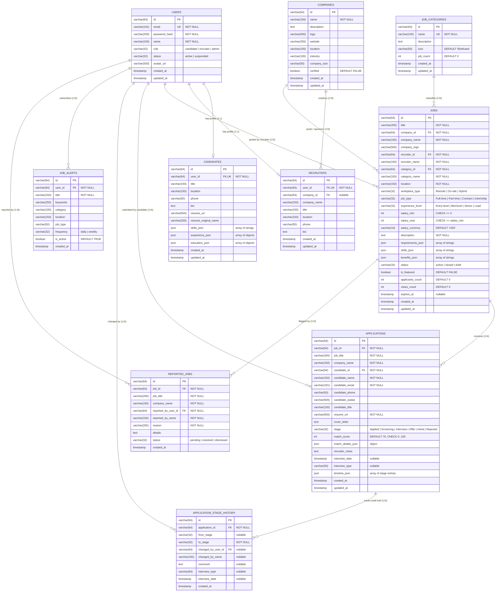

# TalentHub — MySQL 8.0 Database Architecture & Schema Specification

**Target Database:** MySQL 8.0
**Cloud Production Target:** Azure Database for MySQL Flexible Server
**Backend Framework:** Node.js + Express + TypeScript
**Migration Tool:** Knex.js Migration Engine
**Version:** 1.0.0 (Branch: `feature/dbs`)

---

## 1. Architectural Overview & Design Decisions

### 1.1 Multi-Tier Cloud Architecture
TalentHub follows a 3-tier enterprise recruitment architecture aligned with Azure IaaS / AKS Blueprint standards:
1. **Presentation Tier:** React 18 + Vite + TypeScript (SPA)
2. **Application Tier:** Node.js + Express + TypeScript REST API
3. **Data Tier:** MySQL 8.0 (Local Dev & Containerized Simulation) / Azure Database for MySQL Flexible Server (Production)

### 1.2 User Authentication vs. Profile Separation
In accordance with TalentHub security and data separation standards:
- **`users` (Shared Authentication Entity):** Houses credential hashes, core identity (name, email), system role (`candidate`, `recruiter`, `admin`), account status (`active`, `suspended`), and audit timestamps.
- **`candidates` (Physical Profile Entity):** Linked 1-to-1 to `users` via `user_id`. Contains candidate headline/title, location, contact phone, career bio, resume URL, resume original filename, and structured JSON arrays for technical skills, work experience history, and educational credentials.
- **`recruiters` (Physical Profile Entity):** Linked 1-to-1 to `users` via `user_id` and N-to-1 to `companies` via `company_id`. Contains company affiliation, recruiter title, work location, and recruiter bio.
- **Relational Views (`candidate_view`, `recruiter_view`):** SQL views join `users` with profile tables to provide unified records for backward compatibility and fast reporting.

### 1.3 Deletion Policies & Referential Integrity
- **No Unintended Cascades:** Deleting a company or job with active applicant records is restricted (`ON DELETE RESTRICT`) to preserve audit and compliance histories.
- **Cascade on Profile:** Deleting an authentication record (`users`) cascades to its associated physical profile (`candidates` or `recruiters`).
- **Cascade on Audit Logs:** Deleting an application cascades to its internal stage history (`application_stage_history`).

---

## 2. Complete Entity-Relationship Diagram (ERD)



---

## 3. Data Dictionary & Detailed Entity Schema

### 3.1 Entity: `users`
Shared identity and credentials for all platform actors (Job Seekers, Recruiters, Administrators).

| Column | Data Type | Nullable | Default | Constraints | Description |
|---|---|---|---|---|---|
| `id` | `VARCHAR(64)` | NO | None | `PRIMARY KEY` | Unique user identifier (e.g. `user-admin-1`, `user-xxx`) |
| `email` | `VARCHAR(191)` | NO | None | `UNIQUE` | Normalized lowercase email address |
| `password_hash` | `VARCHAR(255)` | NO | None | None | BCrypt-hashed password string |
| `name` | `VARCHAR(150)` | NO | None | None | Full display name |
| `role` | `VARCHAR(32)` | NO | None | `CHECK (role IN ('candidate', 'recruiter', 'admin'))` | System authorization role |
| `status` | `VARCHAR(32)` | NO | `'active'` | `CHECK (status IN ('active', 'suspended'))` | Account lifecycle state |
| `avatar_url` | `VARCHAR(500)` | YES | NULL | None | Remote or local profile image URL |
| `created_at` | `TIMESTAMP` | NO | `CURRENT_TIMESTAMP` | None | Account creation timestamp |
| `updated_at` | `TIMESTAMP` | NO | `CURRENT_TIMESTAMP ON UPDATE CURRENT_TIMESTAMP` | None | Auto-updated record modification timestamp |

- **Indexes:**
  - `PRIMARY KEY (id)`
  - `UNIQUE KEY uq_users_email (email)`
  - `KEY idx_users_role (role)`
  - `KEY idx_users_status (status)`

---

### 3.2 Entity: `candidates`
Dedicated profile attributes for candidate users.

| Column | Data Type | Nullable | Default | Constraints | Description |
|---|---|---|---|---|---|
| `id` | `VARCHAR(64)` | NO | None | `PRIMARY KEY` | Candidate profile identifier (e.g. `cand-xxx` or matches user ID) |
| `user_id` | `VARCHAR(64)` | NO | None | `UNIQUE`, `FK -> users(id) ON DELETE CASCADE` | References base authentication user |
| `title` | `VARCHAR(150)` | YES | NULL | None | Professional headline (e.g., "Senior Full-Stack Cloud Engineer") |
| `location` | `VARCHAR(150)` | YES | NULL | None | Preferred geographic residence / work location |
| `phone` | `VARCHAR(50)` | YES | NULL | None | Contact phone number |
| `bio` | `TEXT` | YES | NULL | None | Professional summary biography |
| `resume_url` | `VARCHAR(500)` | YES | NULL | None | Path or cloud URL to stored resume |
| `resume_original_name` | `VARCHAR(255)` | YES | NULL | None | Original uploaded document filename |
| `skills_json` | `JSON` | YES | NULL | None | Array of skill strings (e.g. `["React", "TypeScript", "MySQL"]`) |
| `experience_json` | `JSON` | YES | NULL | None | Array of work history objects |
| `education_json` | `JSON` | YES | NULL | None | Array of education credentials |
| `created_at` | `TIMESTAMP` | NO | `CURRENT_TIMESTAMP` | None | Profile creation timestamp |
| `updated_at` | `TIMESTAMP` | NO | `CURRENT_TIMESTAMP ON UPDATE CURRENT_TIMESTAMP` | None | Modification timestamp |

- **Indexes:**
  - `PRIMARY KEY (id)`
  - `UNIQUE KEY uq_candidates_user_id (user_id)`
  - `KEY idx_candidates_title (title)`

---

### 3.3 Entity: `recruiters`
Dedicated profile attributes for recruiter and talent acquisition users.

| Column | Data Type | Nullable | Default | Constraints | Description |
|---|---|---|---|---|---|
| `id` | `VARCHAR(64)` | NO | None | `PRIMARY KEY` | Recruiter profile identifier (e.g. `rec-xxx` or matches user ID) |
| `user_id` | `VARCHAR(64)` | NO | None | `UNIQUE`, `FK -> users(id) ON DELETE CASCADE` | References base authentication user |
| `company_id` | `VARCHAR(64)` | YES | NULL | `FK -> companies(id) ON DELETE SET NULL` | Employing organization reference |
| `company_name` | `VARCHAR(150)` | YES | NULL | None | Denormalized company display name |
| `title` | `VARCHAR(150)` | YES | NULL | None | Job title (e.g., "Lead Talent Acquisition Partner") |
| `location` | `VARCHAR(150)` | YES | NULL | None | Recruiter office / base location |
| `phone` | `VARCHAR(50)` | YES | NULL | None | Recruiter business contact number |
| `bio` | `TEXT` | YES | NULL | None | Recruiter bio / hiring mission statement |
| `created_at` | `TIMESTAMP` | NO | `CURRENT_TIMESTAMP` | None | Record creation timestamp |
| `updated_at` | `TIMESTAMP` | NO | `CURRENT_TIMESTAMP ON UPDATE CURRENT_TIMESTAMP` | None | Modification timestamp |

- **Indexes:**
  - `PRIMARY KEY (id)`
  - `UNIQUE KEY uq_recruiters_user_id (user_id)`
  - `KEY idx_recruiters_company_id (company_id)`

---

### 3.4 Entity: `companies`
Hiring organizations sponsoring job requisitions.

| Column | Data Type | Nullable | Default | Constraints | Description |
|---|---|---|---|---|---|
| `id` | `VARCHAR(64)` | NO | None | `PRIMARY KEY` | Company ID (e.g. `comp-1`) |
| `name` | `VARCHAR(150)` | NO | None | None | Legal company name |
| `description` | `TEXT` | YES | NULL | None | Company overview and mission |
| `logo` | `VARCHAR(500)` | YES | NULL | None | Company branding logo URL |
| `website` | `VARCHAR(255)` | YES | NULL | None | Official website URL |
| `location` | `VARCHAR(150)` | YES | NULL | None | Headquarters location |
| `industry` | `VARCHAR(100)` | YES | NULL | None | Business vertical / industry sector |
| `company_size` | `VARCHAR(50)` | YES | NULL | None | Headcount bracket (e.g., "500-1,000 employees") |
| `verified` | `BOOLEAN` | NO | `FALSE` | None | Platform compliance verification badge |
| `created_at` | `TIMESTAMP` | NO | `CURRENT_TIMESTAMP` | None | Creation timestamp |
| `updated_at` | `TIMESTAMP` | NO | `CURRENT_TIMESTAMP ON UPDATE CURRENT_TIMESTAMP` | None | Modification timestamp |

- **Indexes:**
  - `PRIMARY KEY (id)`
  - `KEY idx_companies_name (name)`
  - `KEY idx_companies_verified (verified)`

---

### 3.5 Entity: `job_categories`
Taxonomy categories for filtering and job discovery.

| Column | Data Type | Nullable | Default | Constraints | Description |
|---|---|---|---|---|---|
| `id` | `VARCHAR(64)` | NO | None | `PRIMARY KEY` | Category identifier (e.g. `cat-1`) |
| `name` | `VARCHAR(100)` | NO | None | `UNIQUE` | Distinct category title |
| `description` | `TEXT` | YES | NULL | None | Category description |
| `icon` | `VARCHAR(50)` | NO | `'Briefcase'` | None | Lucide icon identifier |
| `job_count` | `INT` | NO | `0` | None | Aggregated count of active postings |
| `created_at` | `TIMESTAMP` | NO | `CURRENT_TIMESTAMP` | None | Creation timestamp |
| `updated_at` | `TIMESTAMP` | NO | `CURRENT_TIMESTAMP ON UPDATE CURRENT_TIMESTAMP` | None | Modification timestamp |

- **Indexes:**
  - `PRIMARY KEY (id)`
  - `UNIQUE KEY uq_job_categories_name (name)`

---

### 3.6 Entity: `jobs`
Core job requisition posting managed by recruiters and visible to candidates.

| Column | Data Type | Nullable | Default | Constraints | Description |
|---|---|---|---|---|---|
| `id` | `VARCHAR(64)` | NO | None | `PRIMARY KEY` | Job requisition identifier (e.g. `job-1`) |
| `title` | `VARCHAR(200)` | NO | None | None | Job posting title |
| `company_id` | `VARCHAR(64)` | NO | None | `FK -> companies(id) ON DELETE RESTRICT` | Sponsoring company |
| `company_name` | `VARCHAR(150)` | NO | None | None | Denormalized company display name |
| `company_logo` | `VARCHAR(500)` | YES | NULL | None | Denormalized logo URL |
| `recruiter_id` | `VARCHAR(64)` | NO | None | `FK -> users(id) ON DELETE RESTRICT` | Hiring recruiter reference |
| `recruiter_name` | `VARCHAR(150)` | NO | None | None | Denormalized recruiter display name |
| `category_id` | `VARCHAR(64)` | NO | None | `FK -> job_categories(id) ON DELETE RESTRICT` | Classification category |
| `category_name` | `VARCHAR(100)` | NO | None | None | Denormalized category title |
| `location` | `VARCHAR(150)` | NO | None | None | Geographic location or remote description |
| `workplace_type` | `VARCHAR(32)` | NO | None | `CHECK (workplace_type IN ('Remote', 'On-site', 'Hybrid'))` | Working mode |
| `job_type` | `VARCHAR(32)` | NO | None | `CHECK (job_type IN ('Full-time', 'Part-time', 'Contract', 'Internship'))` | Employment classification |
| `experience_level` | `VARCHAR(32)` | NO | None | `CHECK (experience_level IN ('Entry-level', 'Mid-level', 'Senior', 'Lead / Principal'))` | Seniority bracket |
| `salary_min` | `INT` | NO | None | `CHECK (salary_min >= 0)` | Lower salary boundary |
| `salary_max` | `INT` | NO | None | `CHECK (salary_max >= salary_min)` | Upper salary boundary |
| `salary_currency` | `VARCHAR(10)` | NO | `'USD'` | None | Currency code |
| `description` | `TEXT` | NO | None | None | Rich text markdown job description |
| `requirements_json` | `JSON` | YES | NULL | None | Array of requirement bullet strings |
| `skills_json` | `JSON` | YES | NULL | None | Array of target skill strings |
| `benefits_json` | `JSON` | YES | NULL | None | Array of employee benefit strings |
| `status` | `VARCHAR(32)` | NO | `'active'` | `CHECK (status IN ('active', 'closed', 'draft'))` | Lifecycle state |
| `is_featured` | `BOOLEAN` | NO | `FALSE` | None | Elevated visibility on discovery portal |
| `applicants_count` | `INT` | NO | `0` | None | Total applications submitted |
| `views_count` | `INT` | NO | `0` | None | Number of candidate page views |
| `expires_at` | `TIMESTAMP` | YES | NULL | None | Expiration cutoff date |
| `created_at` | `TIMESTAMP` | NO | `CURRENT_TIMESTAMP` | None | Creation timestamp |
| `updated_at` | `TIMESTAMP` | NO | `CURRENT_TIMESTAMP ON UPDATE CURRENT_TIMESTAMP` | None | Modification timestamp |

- **Indexes:**
  - `PRIMARY KEY (id)`
  - `KEY idx_jobs_status (status)`
  - `KEY idx_jobs_company_id (company_id)`
  - `KEY idx_jobs_recruiter_id (recruiter_id)`
  - `KEY idx_jobs_category_id (category_id)`
  - `KEY idx_jobs_feed (status, created_at DESC)` (Optimizes homepage discovery queries)
  - `FULLTEXT KEY ft_jobs_search (title, description, location)` (Optimizes keyword search)

---

### 3.7 Entity: `applications`
Candidate application submission to a specific job requisition.

| Column | Data Type | Nullable | Default | Constraints | Description |
|---|---|---|---|---|---|
| `id` | `VARCHAR(64)` | NO | None | `PRIMARY KEY` | Application identifier (e.g. `app-1`) |
| `job_id` | `VARCHAR(64)` | NO | None | `FK -> jobs(id) ON DELETE RESTRICT` | Target job requisition |
| `job_title` | `VARCHAR(200)` | NO | None | None | Denormalized job title |
| `company_name` | `VARCHAR(150)` | NO | None | None | Denormalized hiring company |
| `candidate_id` | `VARCHAR(64)` | NO | None | `FK -> users(id) ON DELETE RESTRICT` | Submitting candidate user reference |
| `candidate_name` | `VARCHAR(150)` | NO | None | None | Denormalized candidate full name |
| `candidate_email` | `VARCHAR(191)` | NO | None | None | Denormalized candidate email |
| `candidate_phone` | `VARCHAR(50)` | YES | NULL | None | Candidate contact phone |
| `candidate_avatar` | `VARCHAR(500)` | YES | NULL | None | Candidate avatar URL |
| `candidate_title` | `VARCHAR(150)` | YES | NULL | None | Candidate professional title |
| `resume_url` | `VARCHAR(500)` | NO | None | None | Submitted resume document URL |
| `cover_letter` | `TEXT` | YES | NULL | None | Candidate cover message |
| `stage` | `VARCHAR(32)` | NO | `'Applied'` | `CHECK (stage IN ('Applied', 'Screening', 'Interview', 'Offer', 'Hired', 'Rejected'))` | Current ATS pipeline stage |
| `match_score` | `INT` | NO | `70` | `CHECK (match_score BETWEEN 0 AND 100)` | AI computed match score (0–100%) |
| `match_details_json` | `JSON` | YES | NULL | None | Match details breakdown (matchedSkills, missingSkills, notes) |
| `recruiter_notes` | `TEXT` | YES | NULL | None | Private hiring team notes |
| `interview_date` | `TIMESTAMP` | YES | NULL | None | Scheduled interview timestamp |
| `interview_type` | `VARCHAR(50)` | YES | NULL | None | Interview format (`Video Call`, `Technical Round`, etc.) |
| `timeline_json` | `JSON` | YES | NULL | None | Denormalized stage progression timeline array |
| `created_at` | `TIMESTAMP` | NO | `CURRENT_TIMESTAMP` | None | Application submission timestamp |
| `updated_at` | `TIMESTAMP` | NO | `CURRENT_TIMESTAMP ON UPDATE CURRENT_TIMESTAMP` | None | Modification timestamp |

- **Indexes:**
  - `PRIMARY KEY (id)`
  - `UNIQUE KEY uq_app_candidate_job (candidate_id, job_id)` (Guarantees single application per candidate per job)
  - `KEY idx_app_job_id (job_id)`
  - `KEY idx_app_candidate_id (candidate_id)`
  - `KEY idx_app_stage (stage)`
  - `KEY idx_app_match_score (match_score DESC)`
  - `KEY idx_app_pipeline (job_id, stage)` (Optimizes recruiter Kanban board queries)
  - `KEY idx_app_candidate_timeline (candidate_id, created_at DESC)` (Optimizes candidate dashboard pipeline)

---

### 3.8 Entity: `application_stage_history`
Immutable audit log tracking every ATS workflow stage transition.

| Column | Data Type | Nullable | Default | Constraints | Description |
|---|---|---|---|---|---|
| `id` | `VARCHAR(64)` | NO | None | `PRIMARY KEY` | Audit record identifier |
| `application_id` | `VARCHAR(64)` | NO | None | `FK -> applications(id) ON DELETE CASCADE` | Associated application |
| `from_stage` | `VARCHAR(32)` | YES | NULL | None | Previous stage before advance |
| `to_stage` | `VARCHAR(32)` | NO | None | None | Destination stage transitioned to |
| `changed_by_user_id` | `VARCHAR(64)` | YES | NULL | `FK -> users(id) ON DELETE SET NULL` | Recruiter or candidate triggering transition |
| `changed_by_name` | `VARCHAR(150)` | YES | NULL | None | Actor display name |
| `comment` | `TEXT` | YES | NULL | None | Audit notes / feedback |
| `interview_type` | `VARCHAR(64)` | YES | NULL | None | Selected interview format (if interview scheduled) |
| `interview_date` | `TIMESTAMP` | YES | NULL | None | Scheduled interview date/time |
| `created_at` | `TIMESTAMP` | NO | `CURRENT_TIMESTAMP` | None | Transition execution timestamp |

- **Indexes:**
  - `PRIMARY KEY (id)`
  - `KEY idx_stage_hist_app (application_id)`
  - `KEY idx_stage_hist_app_created (application_id, created_at ASC)`

---

### 3.9 Entity: `reported_jobs`
Moderation queue for candidate-reported fraudulent or expired postings.

| Column | Data Type | Nullable | Default | Constraints | Description |
|---|---|---|---|---|---|
| `id` | `VARCHAR(64)` | NO | None | `PRIMARY KEY` | Report identifier |
| `job_id` | `VARCHAR(64)` | NO | None | `FK -> jobs(id) ON DELETE CASCADE` | Flagged job requisition |
| `job_title` | `VARCHAR(200)` | NO | None | None | Denormalized job title |
| `company_name` | `VARCHAR(150)` | NO | None | None | Denormalized company name |
| `reported_by_user_id` | `VARCHAR(64)` | NO | None | `FK -> users(id) ON DELETE CASCADE` | Candidate submitting report |
| `reported_by_name` | `VARCHAR(150)` | NO | None | None | Reporting user name |
| `reason` | `VARCHAR(255)` | NO | None | None | Violation category |
| `details` | `TEXT` | YES | NULL | None | Detailed description of violation |
| `status` | `VARCHAR(32)` | NO | `'pending'` | `CHECK (status IN ('pending', 'resolved', 'dismissed'))` | Moderation status |
| `created_at` | `TIMESTAMP` | NO | `CURRENT_TIMESTAMP` | None | Report submission timestamp |

- **Indexes:**
  - `PRIMARY KEY (id)`
  - `KEY idx_reported_jobs_status (status)`
  - `KEY idx_reported_jobs_job_id (job_id)`

---

### 3.10 Entity: `job_alerts`
Candidate-configured notification preferences.

| Column | Data Type | Nullable | Default | Constraints | Description |
|---|---|---|---|---|---|
| `id` | `VARCHAR(64)` | NO | None | `PRIMARY KEY` | Alert identifier |
| `user_id` | `VARCHAR(64)` | NO | None | `FK -> users(id) ON DELETE CASCADE` | Candidate subscriber |
| `title` | `VARCHAR(150)` | NO | None | None | Saved alert title |
| `keywords` | `VARCHAR(255)` | YES | NULL | None | Match keywords |
| `category` | `VARCHAR(100)` | YES | NULL | None | Target category |
| `location` | `VARCHAR(150)` | YES | NULL | None | Target location |
| `job_type` | `VARCHAR(50)` | YES | NULL | None | Employment type |
| `frequency` | `VARCHAR(32)` | NO | `'daily'` | `CHECK (frequency IN ('daily', 'weekly'))` | Notification interval |
| `is_active` | `BOOLEAN` | NO | `TRUE` | None | Active subscription flag |
| `created_at` | `TIMESTAMP` | NO | `CURRENT_TIMESTAMP` | None | Creation timestamp |

- **Indexes:**
  - `PRIMARY KEY (id)`
  - `KEY idx_job_alerts_user_id (user_id)`

---

## 4. SQL Relational Views

To ensure 100% backward compatibility for queries expecting a combined candidate or recruiter entity:

### 4.1 `candidate_view`
```sql
CREATE OR REPLACE VIEW candidate_view AS
SELECT
    u.id AS user_id,
    c.id AS candidate_id,
    u.email,
    u.name,
    u.role,
    u.status,
    u.avatar_url,
    c.title,
    c.location,
    c.phone,
    c.bio,
    c.resume_url,
    c.resume_original_name,
    c.skills_json,
    c.experience_json,
    c.education_json,
    u.created_at,
    u.updated_at
FROM users u
LEFT JOIN candidates c ON u.id = c.user_id
WHERE u.role = 'candidate';
```

### 4.2 `recruiter_view`
```sql
CREATE OR REPLACE VIEW recruiter_view AS
SELECT
    u.id AS user_id,
    r.id AS recruiter_id,
    u.email,
    u.name,
    u.role,
    u.status,
    u.avatar_url,
    r.company_id,
    r.company_name,
    r.title,
    r.location,
    r.phone,
    r.bio,
    u.created_at,
    u.updated_at
FROM users u
LEFT JOIN recruiters r ON u.id = r.user_id
WHERE u.role = 'recruiter';
```
